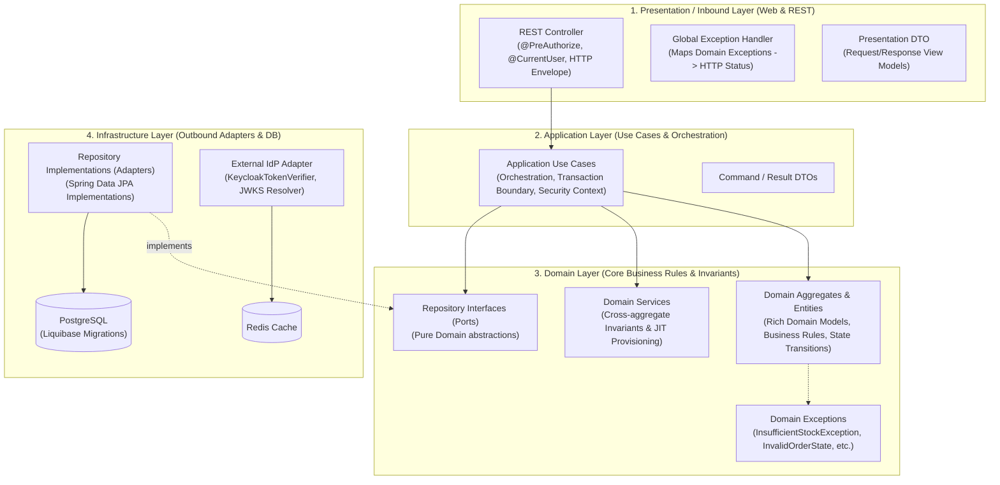

# Enterprise Backend V2

Hệ thống Backend V2 hiện đại với kiến trúc tách rời IdP, xác thực tập trung và kiểm soát phân quyền 2 lớp (**Coarse-Grained tại Gateway** & **Fine-Grained tại Microservices**), được thiết kế tuân thủ nguyên lý **Layered Architecture + Domain-Driven Design (DDD)**.

Tài liệu thiết kế kiến trúc đầy đủ: [docs/ARCHITECTURE_DESIGN.md](./docs/ARCHITECTURE_DESIGN.md)

---

## 🏛 Kiến Trúc Layered Architecture + DDD

Tất cả các microservices nghiệp vụ (`auth-rbac-service`, `inventory-service`, `order-service`) đều tuân thủ cấu trúc 4 tầng chuẩn DDD:



### Chi tiết các tầng trong từng service:
1. **Domain Layer (`domain`)**:
   - `domain.model`: Chứa các Aggregate Root (`Order`, `InventoryItem`, `InternalUser`), Entities và Value Objects. Logic nghiệp vụ cốt lõi và kiểm tra ràng buộc (invariants) nằm tại đây (ví dụ: `order.approve()`, `item.adjustStock()`).
   - `domain.repository`: Chỉ chứa interface trừu tượng của Repository (Port), không phụ thuộc vào Spring Data hay JPA.
   - `domain.service`: Chứa domain services xử lý logic liên quan nhiều thực thể (ví dụ: `UserProvisioningDomainService` điều phối JIT provisioning).
   - `domain.exception`: Chứa các ngoại lệ nghiệp vụ thuần túy (`InsufficientStockException`, `InvalidOrderStateException`, `UserSuspendedException`).
2. **Application Layer (`application`)**:
   - `application.usecase`: Mỗi Use Case là một lớp đảm nhận một kịch bản người dùng cụ thể (`ApproveOrderUseCase`, `AdjustStockUseCase`, `IntrospectTokenUseCase`).
   - `application.dto`: Chứa các Command và Result DTO phục vụ Use Case.
3. **Infrastructure Layer (`infrastructure`)**:
   - `infrastructure.persistence.repository`: Spring Data JPA interfaces và các lớp Adapter hiện thực hóa (implement) Domain Repository interfaces.
   - `infrastructure.idp`: Các Adapter kết nối với Identity Provider (verify token qua JWKS Keycloak, giải mã claim).
   - `infrastructure.config`: Cấu hình Security, Database, Liquibase.
4. **Presentation Layer (`presentation`)**:
   - `presentation.rest`: Các REST Controller nhận request HTTP, kiểm tra phân quyền tiền xử lý với `@PreAuthorize`, chuyển đổi request sang Command và gọi Use Case.
   - `presentation.dto`: DTO dành cho API request/response.
   - `presentation.rest.*ExceptionHandler`: Bắt các Domain Exception để trả về mã HTTP chuẩn xác (400 Bad Request, 404 Not Found).

---

## 📁 Cấu Trúc Thư Mục Dự Án

```
backend-v2/
├── docker-compose.yml                         # Docker Compose điều phối toàn bộ hệ thống
├── docker/
│   ├── init-db/                               # Script khởi tạo 4 database trong PostgreSQL
│   │   └── init-multiple-databases.sh
│   └── keycloak/                              # Cấu hình realm và tài khoản mẫu Keycloak
│       └── enterprise-realm.json
├── docs/                                      # Tài liệu kiến trúc, diagrams, ERD, DDL SQL
│   └── ARCHITECTURE_DESIGN.md
└── code/                                      # Toàn bộ mã nguồn hệ thống
    ├── pom.xml                                # Parent POM (Java 21, Spring Boot 3.3.4, Liquibase, Spring Cloud 2023.0.3)
    ├── common-security/                       # Shared Library: Security Context, Filter, DTOs
    ├── gateway-service/                       # Spring Cloud Gateway (Port 8080)
    │   └── Dockerfile
    ├── auth-rbac-service/                     # Authentication, JIT User & RBAC Engine (Port 8081)
    │   ├── Dockerfile
    │   └── src/main/resources/db/changelog/   # Liquibase migrations cho auth_rbac_db
    ├── inventory-service/                     # Quản lý kho hàng cho ADMIN (Port 8082)
    │   ├── Dockerfile
    │   └── src/main/resources/db/changelog/   # Liquibase migrations cho inventory_db
    └── order-service/                         # Quản lý đơn hàng & phê duyệt cho ADMIN (Port 8083)
        ├── Dockerfile
        └── src/main/resources/db/changelog/   # Liquibase migrations cho order_db
```

---

## 🏗 Danh Sách Services, Ports & Databases

| Service | Port | Container Name | Database / Cache | Mô tả |
| :--- | :--- | :--- | :--- | :--- |
| **`gateway-service`** | `8080` | `backend-v2-gateway` | Redis (cache) | Cửa ngõ API, lọc spoofing header, gọi introspect, kiểm tra quyền thô, inject header |
| **`auth-rbac-service`**| `8081` | `backend-v2-auth-rbac` | `auth_rbac_db` | Verify chữ ký JWT Keycloak, JIT User Provisioning, động cơ RBAC |
| **`inventory-service`**| `8082` | `backend-v2-inventory` | `inventory_db` | Quản lý kho & tồn kho dành cho ADMIN, kiểm tra `@PreAuthorize` |
| **`order-service`**    | `8083` | `backend-v2-order` | `order_db` | Quản lý đơn hàng & duyệt đơn dành cho ADMIN, kiểm tra `@PreAuthorize` |
| **`keycloak`**         | `8180` | `backend-v2-keycloak` | `keycloak_db` | IdP phát hành OIDC token (Dev phase, có thể thay bằng Azure AD/Okta) |
| **`postgres`**         | `5432` | `backend-v2-postgres` | Multi-DB | PostgreSQL 16 (chứa 4 databases riêng biệt) |
| **`redis`**            | `6379` | `backend-v2-redis` | N/A | Redis 7 cho caching introspection token |

---

## 🗄 Cơ Chế DB Migration Với Liquibase

Mỗi service quản lý schema database riêng biệt thông qua **Liquibase**, tự động chạy migration khi container khởi động:
- **`auth-rbac-service`**: Quản lý bảng `internal_users`, `external_users`, `roles`, `permissions`, `role_permissions`, `user_roles` và seed dữ liệu ban đầu.
- **`inventory-service`**: Quản lý bảng `warehouses`, `inventory_items`, `stock_adjustments`.
- **`order-service`**: Quản lý bảng `orders`, `order_items`, `order_approval_logs`.

---

## 🧪 HƯỚNG DẪN CHI TIẾT CHẠY THỬ NGHIỆM HỆ THỐNG

### BƯỚC 1: Khởi động hệ thống với Docker Compose

Di chuyển vào thư mục `backend-v2` và chạy lệnh sau:
```bash
cd backend-v2
docker compose up -d --build
```

Kiểm tra trạng thái các container đang chạy:
```bash
docker compose ps
```
> Tất cả 7 containers (`backend-v2-postgres`, `backend-v2-redis`, `backend-v2-keycloak`, `backend-v2-auth-rbac`, `backend-v2-gateway`, `backend-v2-inventory`, `backend-v2-order`) đều phải ở trạng thái `running` (hoặc `healthy`).

---

### BƯỚC 2: Thông tin tài khoản đăng nhập mẫu (Keycloak)

Keycloak đã được import sẵn Realm `enterprise` với 2 tài khoản:
1. **Super Admin**:
   - Username: `admin`
   - Password: `admin123`
   - Email: `admin@enterprise.com`
   - Vai trò được JIT Provision: `ROLE_ADMIN` (có tất cả quyền quản lý kho và đơn hàng).
2. **Warehouse Manager**:
   - Username: `warehouse_mgr`
   - Password: `pass123`
   - Email: `warehouse.mgr@enterprise.com`
   - Vai trò được gán: `ROLE_INVENTORY_ADMIN`.

Keycloak Web Console: `http://localhost:8180` (admin / admin).

---

### BƯỚC 3: Lấy JWT Access Token từ Keycloak

Chạy lệnh sau trên terminal để lấy token cho tài khoản `admin`:
```bash
ADMIN_TOKEN=$(curl -s -X POST "http://localhost:8180/realms/enterprise/protocol/openid-connect/token" \
  -H "Content-Type: application/x-www-form-urlencoded" \
  -d "grant_type=password" \
  -d "client_id=admin-portal" \
  -d "username=admin" \
  -d "password=admin123" | jq -r .access_token)

echo "Admin Token: $ADMIN_TOKEN"
```

---

### BƯỚC 4: Các Kịch Bản Thử Nghiệm Thực Tế (Test Scenarios)

#### Kịch bản 1: Xác thực SSO, JIT User Provisioning & Caching tại Gateway
Gửi request lấy thông tin người dùng qua Gateway:
```bash
curl -i -X GET http://localhost:8080/api/v1/auth/me \
  -H "Authorization: Bearer $ADMIN_TOKEN"
```
**Kết quả mong đợi:**
- HTTP `200 OK`.
- JSON trả về thông tin `internalUserId`, `userCode` (ví dụ: `USR-0001`), `roles: ["ROLE_ADMIN"]`, `permissions: ["inventory:read", "inventory:stock:adjust", "order:read", "order:approve", "order:cancel"]`.
- Bảng `internal_users` và `external_users` trong `auth_rbac_db` đã tự động sinh bản ghi mới.
- Các request tiếp theo được Gateway lấy trực tiếp từ Redis cache (phản hồi siêu nhanh < 5ms).

---

#### Kịch bản 2: Kiểm tra phân quyền thô tại Gateway (Coarse-Grained Authorization)
Thử gửi request không có Bearer token:
```bash
curl -i -X GET http://localhost:8080/api/v1/inventory/stocks
```
**Kết quả mong đợi:**
- HTTP `401 Unauthorized` từ Gateway: `"Missing or invalid Authorization header"`.

---

#### Kịch bản 3: Chống tấn công giả mạo Header (Header Spoofing Prevention)
Hacker thử gửi request kèm header giả mạo `X-Internal-User-Id: 9999` và `X-User-Roles: ROLE_SUPER_ADMIN`:
```bash
curl -i -X GET http://localhost:8080/api/v1/auth/me \
  -H "Authorization: Bearer $ADMIN_TOKEN" \
  -H "X-Internal-User-Id: 9999" \
  -H "X-User-Roles: ROLE_SUPER_ADMIN"
```
**Kết quả mong đợi:**
- Gateway's `HeaderSanitizationFilter` sẽ quét sạch và xóa triệt để các header giả mạo này, sau đó introspect token thật và inject ID nội bộ chính xác của user từ DB.

---

#### Kịch bản 4: Nghiệp vụ Kho & Phân quyền chi tiết (Inventory Service)

**A. Xem danh sách kho hàng:**
```bash
curl -i -X GET http://localhost:8080/api/v1/inventory/warehouses \
  -H "Authorization: Bearer $ADMIN_TOKEN"
```
*Kết quả:* Trả về danh sách kho hàng (Kho Hà Nội, Kho TP.HCM) do Liquibase seed.

**B. Xem danh sách mặt hàng và số lượng tồn kho:**
```bash
curl -i -X GET http://localhost:8080/api/v1/inventory/stocks \
  -H "Authorization: Bearer $ADMIN_TOKEN"
```

**C. Thực hiện điều chỉnh tăng tồn kho (Hợp lệ):**
```bash
curl -i -X POST http://localhost:8080/api/v1/inventory/stocks/adjust \
  -H "Authorization: Bearer $ADMIN_TOKEN" \
  -H "Content-Type: application/json" \
  -d '{
    "warehouseId": 1,
    "sku": "IPHONE-15-PRO-128",
    "quantityChange": 25,
    "reason": "Nhập kho đợt 1 quý 4"
  }'
```
*Kết quả:* HTTP `200 OK`, số lượng tăng thêm 25, sinh bản ghi audit trong bảng `stock_adjustments` ghi nhận chính xác `adjusted_by = internalUserId`.

**D. Thử nghiệm vi phạm Domain Invariant (Điều chỉnh tồn kho âm quá mức):**
```bash
curl -i -X POST http://localhost:8080/api/v1/inventory/stocks/adjust \
  -H "Authorization: Bearer $ADMIN_TOKEN" \
  -H "Content-Type: application/json" \
  -d '{
    "warehouseId": 1,
    "sku": "IPHONE-15-PRO-128",
    "quantityChange": -99999,
    "reason": "Xuất kho vượt quá tồn"
  }'
```
*Kết quả:* HTTP `400 Bad Request` do Aggregate Root `InventoryItem` ném ra `InsufficientStockException`:
```json
{
  "status": 400,
  "error": "Insufficient Stock",
  "message": "Cannot adjust stock for SKU IPHONE-15-PRO-128 by -99999: remaining stock cannot be negative"
}
```

---

#### Kịch bản 5: Nghiệp vụ Đơn Hàng, Vòng Đời & Duyệt Đơn (Order Service)

**A. Xem danh sách đơn hàng cần duyệt:**
```bash
curl -i -X GET http://localhost:8080/api/v1/orders \
  -H "Authorization: Bearer $ADMIN_TOKEN"
```
*Kết quả:* Trả về đơn hàng `ORD-2026-0001` đang ở trạng thái `PENDING_APPROVAL`.

**B. Phê duyệt đơn hàng (Hợp lệ):**
```bash
curl -i -X POST http://localhost:8080/api/v1/orders/1/approve \
  -H "Authorization: Bearer $ADMIN_TOKEN" \
  -H "Content-Type: application/json" \
  -d '{"comment": "Đã nhận thanh toán từ kế toán, duyệt đơn hàng."}'
```
*Kết quả:* HTTP `200 OK`, đơn hàng chuyển sang trạng thái `APPROVED`, bản ghi audit được lưu vào `order_approval_logs` với `performed_by = internalUserId`.

**C. Thử nghiệm vi phạm Domain Invariant (Duyệt lại đơn hàng đã APPROVED):**
```bash
curl -i -X POST http://localhost:8080/api/v1/orders/1/approve \
  -H "Authorization: Bearer $ADMIN_TOKEN" \
  -H "Content-Type: application/json" \
  -d '{"comment": "Duyệt lại lần nữa"}'
```
*Kết quả:* HTTP `400 Bad Request` do Aggregate Root `Order` ném ra `InvalidOrderStateException`:
```json
{
  "status": 400,
  "error": "Invalid Order State Transition",
  "message": "Order 'ORD-2026-0001' cannot be approved because current status is 'APPROVED'. Only PENDING_APPROVAL orders can be approved."
}
```

---

### BƯỚC 5: Kiểm tra dữ liệu trực tiếp trong PostgreSQL

Nếu bạn muốn kiểm tra các bảng dữ liệu sau khi test:
```bash
# Vào PostgreSQL container
docker exec -it backend-v2-postgres psql -U postgres -d auth_rbac_db -c "SELECT * FROM internal_users;"
docker exec -it backend-v2-postgres psql -U postgres -d auth_rbac_db -c "SELECT * FROM external_users;"
docker exec -it backend-v2-postgres psql -U postgres -d inventory_db -c "SELECT * FROM stock_adjustments;"
docker exec -it backend-v2-postgres psql -U postgres -d order_db -c "SELECT * FROM order_approval_logs;"
```

---

### BƯỚC 6: Dừng hệ thống
```bash
docker compose down
# Hoặc dừng và xóa sạch volume dữ liệu test:
docker compose down -v
```
