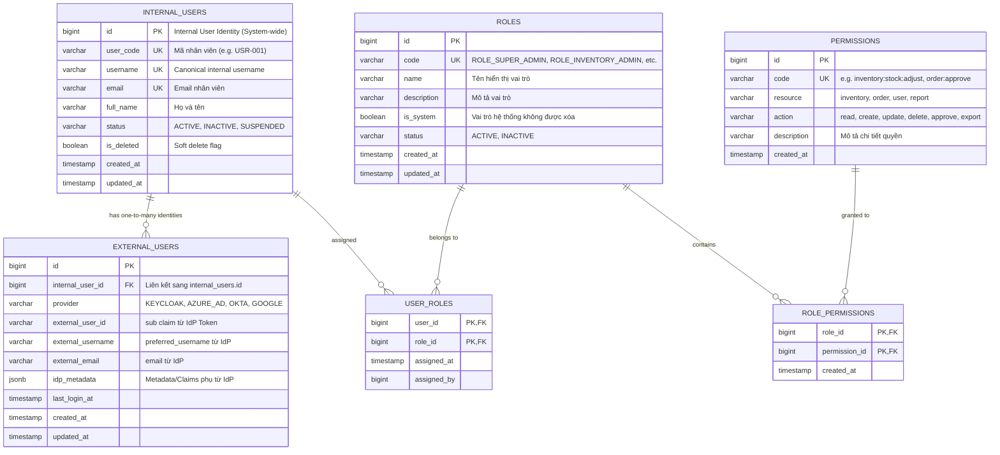
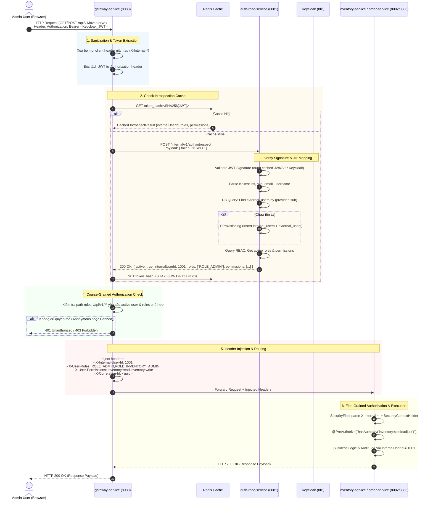

# KIẾN TRÚC HỆ THỐNG BACKEND V2
## Decoupled IdP, API Gateway Coarse Authorization & Fine-Grained RBAC

---

## 1. TỔNG QUAN KIẾN TRÚC (EXECUTIVE SUMMARY)

Hệ thống Backend V2 được thiết kế theo mô hình **Microservices** hiện đại, giải quyết triệt để 3 bài toán trọng tâm:
1. **Decoupled Identity Provider (IdP Independence)**: Tách biệt hoàn toàn tầng xác thực danh tính bên ngoài (Keycloak trong giai đoạn Development/POC, có thể thay thế bằng Azure AD, Okta, Ping Identity, hoặc Google Workspace khi lên Production) khỏi hệ thống quản lý người dùng và phân quyền nội bộ.
2. **Centralized Coarse-Grained Authorization tại API Gateway**: Spring Cloud Gateway đóng vai trò cửa ngõ duy nhất, xác thực token thông qua `auth-rbac-service`, thực hiện kiểm tra quyền thô (coarse-grained access control), làm sạch và inject các header danh tính nội bộ (`X-Internal-User-Id`, `X-User-Roles`, `X-User-Permissions`) trước khi định tuyến.
3. **Decentralized Fine-Grained Authorization tại Business Services**: Các service nghiệp vụ dành cho Admin (`inventory-service`, `order-service`) tin tưởng các header an toàn từ Gateway, giải mã vào `SecurityContext`, và thực thi kiểm tra quyền chi tiết (fine-grained authorization: vai trò, hành vi, dữ liệu sở hữu, trạng thái nghiệp vụ).

---

## 2. SƠ ĐỒ KIẾN TRÚC TỔNG THỂ (SYSTEM ARCHITECTURE)

```mermaid
flowchart TD
    subgraph ClientLayer["Client Layer (Admin Portal)"]
        AdminBrowser["Admin Web App / Next.js"]
    end

    subgraph IdPLayer["Identity Provider (External)"]
        Keycloak["Keycloak (Dev IdP)\n[OIDC / OAuth2 Server]\n*Replaceable by Azure AD/Okta in Prod*"]
    end

    subgraph EdgeLayer["Edge / Gateway Layer"]
        Gateway["gateway-service\n(Spring Cloud Gateway - Reactive)\n- Port: 8080\n- Strip unsafe client headers\n- Token Introspection Filter\n- Coarse-Grained Auth Check\n- Header Injection"]
        RedisCache[("Redis Cache\n(Token Introspection Cache\nTTL: 60s - 300s)")]
    end

    subgraph SecurityDomain["Authentication & RBAC Domain"]
        AuthRBAC["auth-rbac-service\n(Spring Boot 3)\n- Port: 8081\n- JWKS Signature Verification\n- External-to-Internal User Mapping\n- JIT (Just-In-Time) User Provisioning\n- Role-Based Access Control Engine\n- Token Introspect API"]
        AuthDB[("auth_rbac_db (PostgreSQL)\n- internal_users\n- external_users\n- roles\n- permissions\n- role_permissions\n- user_roles")]
    end

    subgraph BusinessDomain["Business Microservices (Admin)"]
        InventorySvc["inventory-service\n(Spring Boot 3)\n- Port: 8082\n- Parse X-Internal-*\n- Fine-Grained Auth (@PreAuthorize)\n- Kho hàng, SKU, Tồn kho"]
        InventoryDB[("inventory_db (PostgreSQL)")]

        OrderSvc["order-service\n(Spring Boot 3)\n- Port: 8083\n- Parse X-Internal-*\n- Fine-Grained Auth (@PreAuthorize)\n- Quản lý đơn, Duyệt đơn, Trạng thái")]
        OrderDB[("order_db (PostgreSQL)")]
    end

    %% Connections
    AdminBrowser -->|"1. SSO Login"| Keycloak
    Keycloak -->|"2. Return JWT"| AdminBrowser
    AdminBrowser -->|"3. API Request + Bearer JWT"| Gateway

    Gateway <-->|"4. Check / Put Token Cache"| RedisCache
    Gateway -->|"5. Introspect JWT (Cache Miss)"| AuthRBAC
    AuthRBAC <-->|"Validate JWKS"| Keycloak
    AuthRBAC <-->|"Read/Write User & RBAC"| AuthDB
    AuthRBAC -->|"6. Return Internal User & Roles"| Gateway

    Gateway -->|"7. Forward + Injected Headers"| InventorySvc
    Gateway -->|"7. Forward + Injected Headers"| OrderSvc

    InventorySvc <--> InventoryDB
    OrderSvc <--> OrderDB
```

---

## 3. THIẾT KẾ CƠ SỞ DỮ LIỆU (DATABASE & RBAC SCHEMA)

Hệ sinh thái lưu trữ thông tin xác thực và phân quyền nằm hoàn toàn trong `auth_rbac_db`, đảm bảo tính độc lập với IdP.

### 3.1. Sơ đồ Quan hệ Thực thể (ERD)



### 3.2. Script DDL Chi Tiết (PostgreSQL)

```sql
-- 1. Bảng người dùng nội bộ (Internal Users)
CREATE TABLE internal_users (
    id BIGSERIAL PRIMARY KEY,
    user_code VARCHAR(50) NOT NULL UNIQUE,
    username VARCHAR(100) NOT NULL UNIQUE,
    email VARCHAR(255) NOT NULL UNIQUE,
    full_name VARCHAR(255) NOT NULL,
    status VARCHAR(30) NOT NULL DEFAULT 'ACTIVE',
    is_deleted BOOLEAN NOT NULL DEFAULT FALSE,
    created_at TIMESTAMP WITH TIME ZONE DEFAULT CURRENT_TIMESTAMP,
    updated_at TIMESTAMP WITH TIME ZONE DEFAULT CURRENT_TIMESTAMP
);

CREATE INDEX idx_internal_users_status ON internal_users(status) WHERE is_deleted = FALSE;

-- 2. Bảng định danh người dùng từ IdP bên ngoài (External Users)
CREATE TABLE external_users (
    id BIGSERIAL PRIMARY KEY,
    internal_user_id BIGINT NOT NULL REFERENCES internal_users(id) ON DELETE CASCADE,
    provider VARCHAR(50) NOT NULL,           -- 'KEYCLOAK', 'AZURE_AD', 'OKTA'
    external_user_id VARCHAR(255) NOT NULL,  -- sub claim từ JWT của IdP
    external_username VARCHAR(100),          -- preferred_username
    external_email VARCHAR(255),
    idp_metadata JSONB DEFAULT '{}'::jsonb,
    last_login_at TIMESTAMP WITH TIME ZONE,
    created_at TIMESTAMP WITH TIME ZONE DEFAULT CURRENT_TIMESTAMP,
    updated_at TIMESTAMP WITH TIME ZONE DEFAULT CURRENT_TIMESTAMP,
    CONSTRAINT uk_provider_external_id UNIQUE (provider, external_user_id)
);

CREATE INDEX idx_external_users_lookup ON external_users(provider, external_user_id);
CREATE INDEX idx_external_users_internal_id ON external_users(internal_user_id);

-- 3. Bảng Vai trò (Roles)
CREATE TABLE roles (
    id BIGSERIAL PRIMARY KEY,
    code VARCHAR(50) NOT NULL UNIQUE,        -- e.g. 'ROLE_SUPER_ADMIN', 'ROLE_INVENTORY_ADMIN', 'ROLE_ORDER_ADMIN'
    name VARCHAR(100) NOT NULL,
    description TEXT,
    is_system BOOLEAN NOT NULL DEFAULT FALSE,
    status VARCHAR(20) NOT NULL DEFAULT 'ACTIVE',
    created_at TIMESTAMP WITH TIME ZONE DEFAULT CURRENT_TIMESTAMP,
    updated_at TIMESTAMP WITH TIME ZONE DEFAULT CURRENT_TIMESTAMP
);

-- 4. Bảng Quyền hạn chi tiết (Permissions)
CREATE TABLE permissions (
    id BIGSERIAL PRIMARY KEY,
    code VARCHAR(100) NOT NULL UNIQUE,       -- e.g. 'inventory:stock:adjust', 'order:approve'
    resource VARCHAR(50) NOT NULL,           -- 'inventory', 'order', 'user'
    action VARCHAR(50) NOT NULL,             -- 'read', 'create', 'update', 'delete', 'approve'
    description TEXT,
    created_at TIMESTAMP WITH TIME ZONE DEFAULT CURRENT_TIMESTAMP
);

-- 5. Bảng liên kết Vai trò - Quyền hạn (Role-Permission Mapping)
CREATE TABLE role_permissions (
    role_id BIGINT NOT NULL REFERENCES roles(id) ON DELETE CASCADE,
    permission_id BIGINT NOT NULL REFERENCES permissions(id) ON DELETE CASCADE,
    created_at TIMESTAMP WITH TIME ZONE DEFAULT CURRENT_TIMESTAMP,
    PRIMARY KEY (role_id, permission_id)
);

-- 6. Bảng gán Vai trò cho Người dùng nội bộ (User-Role Mapping)
CREATE TABLE user_roles (
    user_id BIGINT NOT NULL REFERENCES internal_users(id) ON DELETE CASCADE,
    role_id BIGINT NOT NULL REFERENCES roles(id) ON DELETE CASCADE,
    assigned_at TIMESTAMP WITH TIME ZONE DEFAULT CURRENT_TIMESTAMP,
    assigned_by BIGINT,
    PRIMARY KEY (user_id, role_id)
);
```

### 3.3. Cơ Chế Just-In-Time (JIT) Provisioning & Độc Lập IdP

Khi người dùng đăng nhập qua SSO (Keycloak hoặc bất kỳ IdP nào trong tương lai):
1. **Trích xuất thông tin định danh**:
   - `provider`: Được xác định dựa vào cấu hình hoặc Issuer URL (`iss`) trong JWT (ví dụ: `http://localhost:8080/realms/master` -> `KEYCLOAK`).
   - `sub`: ID duy nhất của user do IdP sinh ra.
   - `email`, `preferred_username`, `name`.
2. **Kiểm tra liên kết tài khoản**:
   - Truy vấn `external_users` theo cặp `(provider, external_user_id)`.
   - **Trường hợp đã tồn tại**:
     - Lấy `internal_user_id`.
     - Kiểm tra trạng thái `internal_users.status == 'ACTIVE'`.
     - Cập nhật `last_login_at` và `idp_metadata`.
   - **Trường hợp CHƯA tồn tại (Lần đầu SSO)**:
     - Khởi tạo transaction nguyên tử:
       1. Kiểm tra xem `email` đã có trong `internal_users` chưa (để hỗ trợ account linking nếu cùng 1 nhân viên đăng nhập qua provider mới).
       2. Nếu chưa có: Tạo mới bản ghi trong `internal_users` với trạng thái `ACTIVE`.
       3. Tạo bản ghi mới trong `external_users` liên kết với `internal_user_id` vừa tạo/tìm thấy.
       4. Gán vai trò mặc định ban đầu (ví dụ: `ROLE_STAFF` hoặc chờ Admin gán quyền theo chính sách bảo mật nội bộ).
3. **Lợi ích kiến trúc**:
   - **Khi chuyển từ Keycloak sang Azure AD**: Chỉ cần cập nhật cấu hình JWKS Endpoint và quy tắc nhận diện provider. Bảng `internal_users` cùng toàn bộ lịch sử đơn hàng, kho bãi, bảng gán quyền `roles` / `permissions` được giữ nguyên vẹn 100%, không bị phụ thuộc vào ID format của Keycloak.

---

## 4. CHI TIẾT LUỒNG REQUEST & BẢO MẬT (REQUEST FLOW)



---

## 5. MA TRẬN PHÂN CHIA TRÁCH NHIỆM: COARSE VS FINE-GRAINED AUTH

| Tiêu chí | Coarse-Grained Authorization (Gateway) | Fine-Grained Authorization (Business Services) |
| :--- | :--- | :--- |
| **Vị trí thực thi** | `gateway-service` (Global WebFilter) | `inventory-service`, `order-service` (Security Interceptor / AOP) |
| **Phạm vi kiểm tra** | Cấp độ giao thức & đường dẫn URL (Path-level):<br/>- Token có hợp lệ, chưa hết hạn không?<br/>- Người dùng có bị khóa tài khoản không?<br/>- Người dùng có vai trò cơ bản (e.g. `ROLE_ADMIN` để vào `/api/v1/admin/**`)? | Cấp độ hành vi & dữ liệu nghiệp vụ (Method & Domain-level):<br/>- Kiểm tra quyền chi tiết: `@PreAuthorize("hasAuthority('order:approve')")`<br/>- Giới hạn hạn mức duyệt: Đơn hàng > 50 triệu cần `ROLE_DIRECTOR`<br/>- Kiểm tra quyền chi nhánh: User chỉ xem tồn kho thuộc chi nhánh mình phụ trách |
| **Dữ liệu đầu vào** | Bearer JWT, Path, Method | Headers: `X-Internal-User-Id`, `X-User-Roles`, `X-User-Permissions`, Request Body, Dữ liệu từ Database của service |
| **Tác vụ bổ trợ** | Strip client headers nguy hiểm, Rate limiting, Tracing ID | Ghi Audit Log (`created_by`, `updated_by` = `internalUserId`), Enforce Business Invariants |

---

## 6. PHÒNG CHỐNG CÁC LỖ HỔNG BẢO MẬT ĐẶC THÙ

1. **Header Spoofing / Injection Prevention**:
   - *Nguy cơ*: Hacker từ ngoài Internet tự gửi request kèm header `X-Internal-User-Id: 1` và `X-User-Roles: ROLE_SUPER_ADMIN`.
   - *Giải pháp*: `gateway-service` thực thi bộ lọc tiền xử lý đầu tiên: xóa triệt để tất cả các header có tiền tố `X-Internal-*` và `X-User-*` được gửi từ bên ngoài trước khi thực hiện bất kỳ logic nào. Chỉ có Gateway mới có quyền inject các header này vào request forwarded.
2. **Network Isolation**:
   - Các business service (`inventory-service`, `order-service`) và `auth-rbac-service` chỉ mở port trong mạng nội bộ (Internal K8s Network / Docker Network). Bên ngoài Internet chỉ có thể chạm vào duy nhất port của `gateway-service`.
3. **Hiệu năng & Tránh Bottleneck tại Gateway**:
   - Nếu mỗi request gửi đến Gateway đều gọi đồng bộ sang `auth-rbac-service`, hệ thống sẽ bị overhead mạng lớn.
   - *Giải pháp*: Caching kết quả phân quyền tại Redis (hoặc Caffeine Local Cache tại Gateway) với key là `SHA-256(JWT)` và TTL ngắn (60s - 120s, nhỏ hơn thời gian sống còn lại của JWT). Khi user gửi 100 requests liên tục, chỉ có request đầu tiên gọi sang `auth-rbac-service`.

---

## 7. CẤU TRÚC THƯ MỤC & THIẾT KẾ LAYERED ARCHITECTURE + DDD

Dự án áp dụng chặt chẽ mô hình **Layered Architecture + Domain-Driven Design (DDD)** cho toàn bộ các microservices. Mỗi service được chia thành 4 tầng rõ ràng:
1. **Domain Layer**: Chứa Aggregate Roots (`Order`, `InventoryItem`, `InternalUser`), Entities, Value Objects, Domain Exceptions và Repository Interfaces (Ports). Mọi logic kiểm tra tính đúng đắn của dữ liệu nghiệp vụ (Business Invariants) đều được đóng gói tại đây.
2. **Application Layer**: Chứa các Use Cases độc lập (`ApproveOrderUseCase`, `AdjustStockUseCase`, `IntrospectTokenUseCase`) điều phối luồng thực thi và quản lý transaction.
3. **Infrastructure Layer**: Chứa các Adapter công nghệ (Spring Data JPA Repositories, IdP Verifier, Redis Caching, Liquibase Migrations).
4. **Presentation Layer**: Chứa REST Controllers, API DTOs, Global Exception Handlers và Web Filters.

```
next-ui/
└── backend-v2/                                # Thư mục Backend V2
    ├── docker-compose.yml                     # Docker Compose điều phối 7 containers
    ├── README.md                              # Hướng dẫn chi tiết chạy & test cURL
    ├── docker/
    │   ├── init-db/init-multiple-databases.sh # Khởi tạo 4 databases trong Postgres
    │   └── keycloak/enterprise-realm.json     # Import sẵn realm & demo users
    ├── docs/
    │   └── ARCHITECTURE_DESIGN.md             # Tài liệu thiết kế kiến trúc chi tiết
    │
    └── code/                                  # Thư mục mã nguồn chung
        ├── pom.xml                            # Root POM (Java 21, Spring Boot 3.3.4, Liquibase 4.27.0)
        ├── common-security/                   # Shared Security Library
        │   ├── annotation/                    # @CurrentUser
        │   ├── constant/                      # X-Internal-User-Id, X-User-Roles, ...
        │   ├── context/                       # UserContext, UserContextHolder
        │   ├── dto/                           # IntrospectResponse
        │   └── filter/                        # InternalSecurityContextFilter
        │
        ├── gateway-service/                   # API Gateway (Spring Cloud Gateway Reactive)
        │   ├── Dockerfile
        │   └── src/main/java/com/enterprise/backend/gateway/
        │       ├── infrastructure/config/     # GatewayConfig (WebClient)
        │       └── presentation/filter/       # HeaderSanitizationFilter, TokenIntrospectionFilter
        │
        ├── auth-rbac-service/                 # Authentication, JIT User & RBAC Core
        │   ├── Dockerfile
        │   └── src/main/java/com/enterprise/backend/auth/
        │       ├── domain/
        │       │   ├── model/                 # InternalUser, ExternalUser, Role, Permission
        │       │   ├── repository/            # InternalUserRepository, ExternalUserRepository (Interfaces)
        │       │   ├── service/               # UserProvisioningDomainService (JIT Domain Logic)
        │       │   └── exception/             # UserSuspendedException, InvalidTokenException
        │       ├── application/
        │       │   └── usecase/               # IntrospectTokenUseCase
        │       ├── infrastructure/
        │       │   ├── idp/                   # KeycloakTokenVerifier, IdpClaims
        │       │   └── persistence/           # Spring Data JPA Repository Implementations
        │       └── presentation/
        │           ├── rest/                  # InternalAuthController, UserAuthController
        │           └── dto/                   # TokenApiRequest
        │
        ├── inventory-service/                 # Admin Inventory Management
        │   ├── Dockerfile
        │   └── src/main/java/com/enterprise/backend/inventory/
        │       ├── domain/
        │       │   ├── model/                 # InventoryItem (Aggregate Root), Warehouse, StockAdjustment
        │       │   ├── repository/            # InventoryItemRepository, WarehouseRepository
        │       │   └── exception/             # InsufficientStockException, InventoryItemNotFoundException
        │       ├── application/
        │       │   ├── dto/                   # AdjustStockCommand
        │       │   └── usecase/               # AdjustStockUseCase, GetInventoryUseCase
        │       ├── infrastructure/persistence/# JPA Entities & Repositories
        │       └── presentation/
        │           ├── rest/                  # AdminInventoryController, InventoryGlobalExceptionHandler
        │           └── dto/                   # AdjustStockApiRequest
        │
        └── order-service/                     # Admin Order Management
            ├── Dockerfile
            └── src/main/java/com/enterprise/backend/order/
                ├── domain/
                │   ├── model/                 # Order (Aggregate Root), OrderItem, OrderStatus, ApprovalLog
                │   ├── repository/            # OrderRepository, OrderApprovalLogRepository
                │   └── exception/             # InvalidOrderStateException, OrderNotFoundException
                ├── application/
                │   ├── dto/                   # ApproveOrderCommand, CancelOrderCommand
                │   └── usecase/               # ApproveOrderUseCase, CancelOrderUseCase, GetOrdersUseCase
                ├── infrastructure/persistence/# JPA Entities & Repositories
                └── presentation/
                    ├── rest/                  # AdminOrderController, OrderGlobalExceptionHandler
                    └── dto/                   # ApprovalDecisionApiRequest
```

---

## 8. HỢP ĐỒNG GIAO TIẾP NỘI BỘ (INTERNAL CONTRACT SPECIFICATION)

### 8.1. API Introspection (`auth-rbac-service`)
- **Endpoint**: `POST /internal/v1/auth/introspect`
- **Request Body**:
  ```json
  {
    "token": "eyJhbGciOiJSUzI1NiIsInR5cCI6IkpXVCJ9..."
  }
  ```
- **Response Body (200 OK)**:
  ```json
  {
    "active": true,
    "internalUserId": 1001,
    "userCode": "USR-0001",
    "username": "admin_kho",
    "email": "admin.kho@enterprise.com",
    "fullName": "Nguyễn Văn Kho",
    "provider": "KEYCLOAK",
    "externalUserId": "4b68ff58-2c40-4dc6-b518-80949d038ef2",
    "roles": [
      "ROLE_ADMIN",
      "ROLE_INVENTORY_MANAGER"
    ],
    "permissions": [
      "inventory:stock:read",
      "inventory:stock:adjust",
      "order:read"
    ],
    "expiresAt": 1729864200
  }
  ```
- **Response Body (401 Unauthorized / Token không hợp lệ)**:
  ```json
  {
    "active": false,
    "errorMessage": "Token signature invalid or expired"
  }
  ```

### 8.2. Danh sách HTTP Header được Gateway Inject vào Downstream Services
| Header Name | Kiểu dữ liệu | Ví dụ | Mục đích |
| :--- | :--- | :--- | :--- |
| `X-Internal-User-Id` | String (Long) | `1001` | ID người dùng nội bộ chuẩn hóa duy nhất |
| `X-User-Code` | String | `USR-0001` | Mã nhân viên phục vụ audit log |
| `X-User-Name` | String | `admin_kho` | Tên đăng nhập |
| `X-User-Roles` | Comma-separated | `ROLE_ADMIN,ROLE_INVENTORY_MANAGER` | Danh sách vai trò để Spring Security map vào `GrantedAuthority` |
| `X-User-Permissions` | Comma-separated | `inventory:stock:read,inventory:stock:adjust` | Danh sách quyền chi tiết cho `@PreAuthorize` |
| `X-Correlation-Id` | UUID | `e837f485-3e28-40b9-87a1-872f2d57e2bb` | Phục vụ Distributed Tracing xuyên suốt các service |
